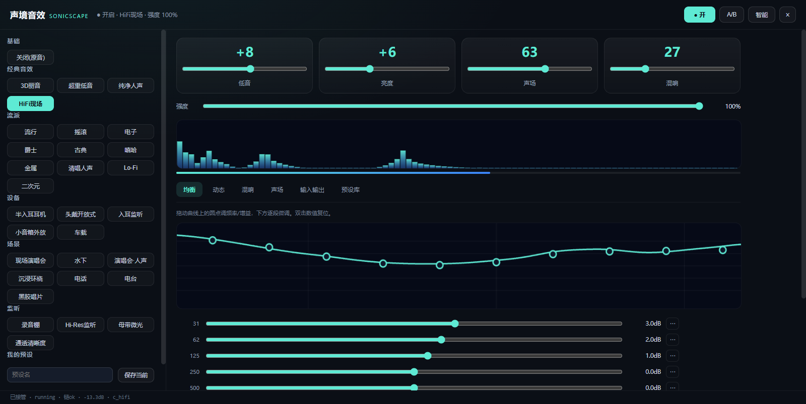
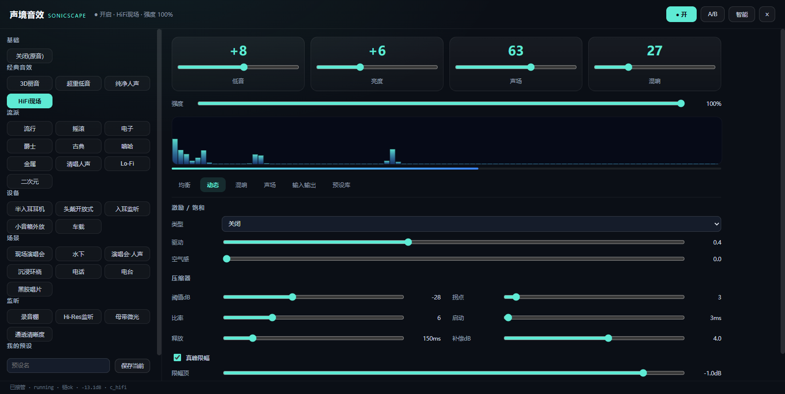
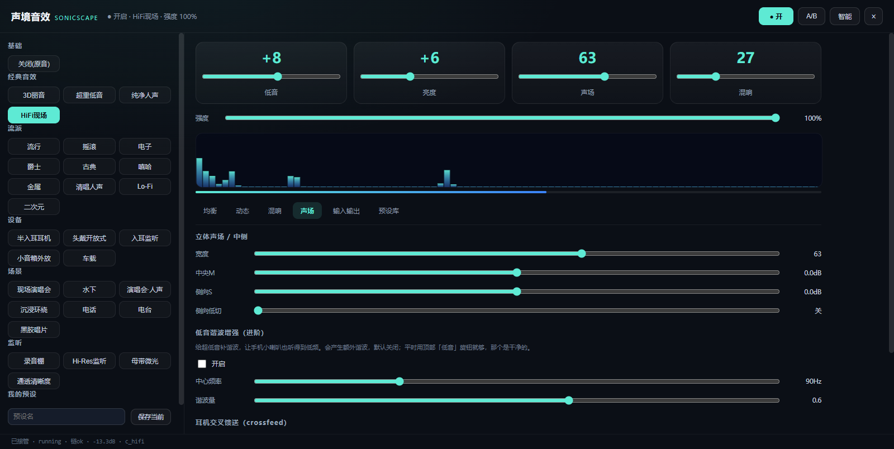
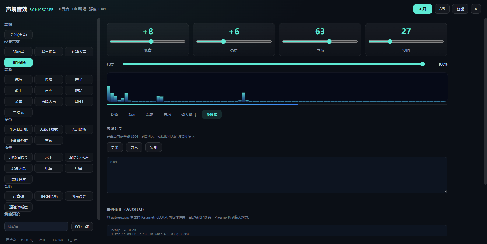

# 声境音效 SonicScape

MoeKoe Music 的全屏音效调音台。点播放栏的 ♪ 打开，边听边调，关掉面板所有绘制停止。



## 装

**插件市场（推荐）**
设置 → 插件管理 → 插件市场 → 搜「声境音效」→ 安装 → 刷新页面。

**手动**
下载本仓库，把整个文件夹放进 `%APPDATA%\moekoemusic\extensions\`，然后 设置 → 插件 → 刷新插件。
也可以在 设置 → 插件管理 → 安装插件 里直接选本仓库的 zip。

需要 MoeKoe Music 1.7.0 或更高。

## 界面

左边是 31 套预设，按 基础 / 经典音效 / 流派 / 设备 / 场景 / 监听 分组平铺，不用横向滚。右边是四个旋钮、强度、实时频谱和六个高级标签。

旋钮直接显示实际增益，低音拉满就是 +15，亮度 +18。双击任何旋钮或数值复位。

快捷键
- `Alt+Shift+S` 开关音效
- `Alt+Shift+P` 开面板
- `Alt+Shift+M` 智能调音
- `Esc` 关面板

## 功能

### 音色
- **低音**，三层。88Hz 低架最多 +15dB，再按音乐低频能量动态补最多 +12dB（低频本来足就少补，不会糊），另有可选谐波层给手机小喇叭补感知低频
- **亮度**，两段。6.5kHz 高架最多 +18dB，加 2.8kHz 轮廓 +8dB
- **齿音保护**，常开。5-9kHz 尖峰过强时自动压最多 6dB，只压那一下，不动整体
- **等响补偿**，低音和亮度提升时自动让出 3-6dB 余量，不破音



### 动态
- 激励 / 饱和，电子管 / 磁带 / 柔和三种，驱动和空气感都能拉到极端失真
- 压缩器，阈值 -45 到 0，比率 1 到 20，补偿 ±24。阈值越低自动补越多音量，拉满听感是「很响很平」而不是「变小声」
- 真峰限幅

### 空间
- 卷积混响，7 种空间加自定义 .wav IR，湿度 0-120%，预延时 0-300ms，尺寸 0.5-6
- M/S 声场，宽度、中央和侧向增益 ±18dB、侧向低切
- 耳机交叉馈送，照 bs2b 的 Bauer 做法，三档加混合量，久听不累



### 均衡
- 10 段全参数 EQ，支持峰值 / 低架 / 高架 / 低通 / 高通
- 曲线用真实 biquad 幅频响应绘制，拖圆点直接改频率和增益
- **AutoEQ 导入**，把 autoeq.app 生成的 ParametricEQ.txt 粘进来，自动铺到 10 段并处理 Preamp



### 响度
ITU-R BS.1770 的 K 加权，目标 -14 LUFS，1 秒平滑，不会抽吸。

### 预设
31 套内置，可以存自己的、导出 JSON 分享给别人、导入别人的配置。

## 性能

- 切预设 1ms 左右
- 混响 IR 按空间和尺寸缓存，空闲预生成，换 buffer 延后执行
- 面板关闭时 rAF 取消，频谱和曲线不再绘制
- EQ 控件一次建好，切预设只更新数值

## 兼容

- 只在主界面建按钮和面板，歌词页和桌面歌词窗口不出现控件，音频接管始终有效
- 底部按宿主播放栏实际高度留白，窗口缩放自动跟随
- 窄屏自动收窄左栏、旋钮两列
- 音量静音由插件补偿，宿主滑块照常

## 已知限制

- 混响用合成脉冲响应近似空间感，导入自定义 IR 更真实
- 响度是 K 加权加指数平滑的近似，误差约 ±1LU
- EQ 曲线的低通高通段用线性 Q 近似

## 开发

源码按段写在 `src_p1.js` 到 `src_p7.js`，拼接成 `sonic-scape.js`。改完要 `electronAPI.reloadExtensions()` 再刷新页面才生效。

```
src_p1  状态、预设、IR 定义
src_p2  节点图与连线
src_p3  各模块 apply
src_p4  智能、快捷键、总开关
src_p5  UI 基础组件
src_p6  旋钮、均衡页
src_p6b 动态/混响/声场/IO/预设库页
src_p7  渲染循环、诊断、装配
```

调研笔记在 `docs/research/`，改进方案在 `docs/PLAN-v5.md`，更新日志在 `CHANGELOG.md`。

## 许可

MIT
